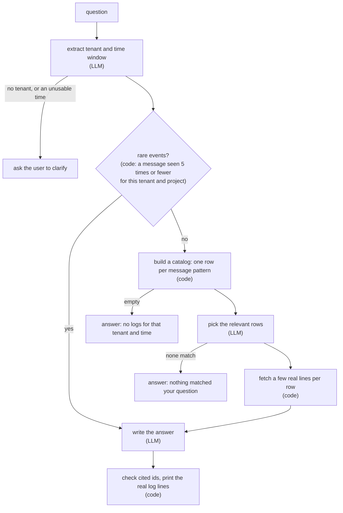

# logintel

A **read-only** agent that answers plain-English questions about your logs and **cites the real log lines** behind every answer.

```
$ logintel ask "What caused the 503 errors for TENANT-X around 12:02-12:03?" --use-case incident

path: rare_events
extracted: tenant=TENANT-X start=2026-05-26 12:02:00 end=2026-05-26 12:03:00
answer: At 12:02:58.378 the DataSource (com.service.db.DataSource) logged a ConnectionTimeoutException:
        "Timeout waiting for idle connection after 3000ms" ... At 12:02:58.408 the circuit breaker
        (com.service.circuit.Breaker) recorded State Changed: CLOSED -> OPEN ...
confidence: high
  cited: 2026-05-26T12:02:58.378 ERROR com.service.db.DataSource pool.ConnectionTimeoutException: Timeout waiting for idle connection after 3000ms.
  cited: 2026-05-26T12:02:58.408 WARN com.service.circuit.Breaker State Changed: CLOSED -> OPEN. Reason: High error rate in DB component. Target: [DB-Cluster-01]
```

The `cited:` lines are copied from the logs by code, not written by the model. The agent never writes to your logs.

> **Status: v0.1.0, runnable, not complete.** It has been tried only on the synthetic logs in `demo_data/`, not on production logs. See [Known limits](#known-limits).

## How it works

Logs live in [Loki](https://grafana.com/oss/loki/). A question goes through these steps:



- A rare event (a message seen at most 5 times for a tenant) is usually the interesting one, so it is tried first and gives a `high` confidence answer.
- If nothing is rare, the model sees only a compact **catalog** of message patterns (not raw logs), picks the relevant rows, and code fetches the real lines for them. That answer is at most `medium`.
- Cases that need no further model call (no logs, a time outside the data, a missing tenant) are answered by code.
- A question costs 2 model calls on the rare-event path and 3 on the catalog path (one more if the row picker returns nothing and is asked to confirm).

## Quickstart

You need Python 3.11+, Docker, and an OpenAI API key.

```bash
# 1. install
git clone https://github.com/OmGholap/logintel-agent.git && cd logintel-agent
python -m venv venv && source venv/bin/activate
pip install -e .
cp .env.example .env            # then put your OPENAI_API_KEY in .env

# 2. start Loki (and Grafana)
docker compose up -d

# 3. load the demo logs into Loki (about 10,000 lines)
logintel load

# 4. ask
logintel ask "What caused the 503 errors for TENANT-X around 12:02-12:03?" --use-case incident
```

`docker compose down` stops it; add `-v` to also delete the loaded logs (run `logintel load` again afterwards).

Other questions to try on the demo data:

```bash
logintel ask "Were there any pool connection warnings for TENANT-X between 12:02:00 and 12:02:56?"
logintel ask "What happened to TENANT-A around 12:02?"
logintel ask "What happened to TENANT-X at 13:00?"      # there are no logs then: answered without the model
```

Set `RCA_DEBUG=1` to print the catalog the agent builds.

### The demo data

`demo_data/` holds two synthetic log files (about 5,000 lines each) dated 26 May 2026: `production_incident_01.log` (a database timeout at 12:02:58, then a circuit breaker opening and 503 errors for TENANT-X) and `auth_rate_limit_noise.log` (an auth rate-limit spike around 14:00). `logintel load` pushes them into Loki as two projects, `incident` and `noise` (a Loki label called `use_case`).

### See the logs in Grafana

`docker compose up -d` also starts Grafana with Loki already connected. Open
<http://localhost:3000/d/logintel-demo/logintel-demo-logs> (it shows the incident minute; the first load takes about 10 seconds). Use the time picker to move to the 14:00 noise window.

The demo dashboard is only for local use: it turns login off and makes everyone an editor. Do not expose it to a network.

The logs are dated May 2026, so Grafana's default "last few hours" views are empty. Use the dashboard link above or set an absolute time range.

## Use it from Python

```python
from logintel import Agent

agent = Agent()                                   # reads settings from the environment / .env
answer = agent.ask("What caused the 503 errors for TENANT-X around 12:02?", use_case="incident")

print(answer.answer, answer.confidence)           # the text and "high" | "medium" | "low"
print(*answer.citations, sep="\n")                # the real log lines it rests on
print(answer.path)                                # rare_events | selector | no_logs | no_match | clarify | error
```

`use_case` limits the search to one Loki project (`None` searches all of them). The logs are read from Loki into memory and reused for 60 seconds per project. See [`examples/ask.py`](examples/ask.py).

## Configuration

Environment variables (or a `.env` file in the working directory):

| Variable | Default | Meaning |
|---|---|---|
| `OPENAI_API_KEY` | none, required for `ask` | OpenAI key |
| `OPENAI_CHAT_MODEL` | `gpt-5-mini` | chat model |
| `LOKI_URL` | `http://localhost:3100` | Loki address |
| `LOKI_USER`, `LOKI_PASSWORD` | none | basic auth, if your Loki needs it |
| `LOGINTEL_LOOKBACK_DAYS` | `365` | how far back to read logs |
| `LOGINTEL_SNAPSHOT_TTL` | `60` | seconds to reuse logs read from Loki |

Your logs must look like this, one entry per line, with stack-trace lines indented underneath:

```
2026-05-26T12:00:00.090Z [TENANT-X] INFO  [com.service.gateway.Ingress] Request processed successfully. Status=200
```

## Tests

```bash
pip install -e ".[dev]"
pytest
```

39 tests, no network and no API key needed (the model and Loki are faked). `golden_queries.md` records the real-model runs of 14 hand-written questions.

## Known limits

- **Only tried on synthetic data.** Nothing here has been run on production logs.
- **Answers vary between runs.** The model is not deterministic. On the demo data the root cause and cited lines were stable across repeated runs, but the confidence label was not always: the same correct answer was sometimes `medium` or `low` where `high` was expected (3 of 9 runs on one query). The label is advice, not a guarantee.
- **The model can pick the wrong rows.** On the catalog path, a vague question gets a vague selection, and the right message pattern can be missed. A question about something that is not in the logs is answered "nothing matched", but a question that matches loosely can still pull in unrelated rows.
- **Citations are checked, prose is not.** Code guarantees that every cited line is a real log line the model was shown. It does not verify that the explanation in the text is fully supported by those lines, though the prompt tells the model not to claim effects the logs do not show.
- **"Rare" is a simple rule.** A message seen 5 times or fewer for a tenant (per project) in the window read from Loki. A genuinely serious message that repeats often is not "rare" and goes through the catalog path.
- **Message patterns come from regexes.** Numbers, durations, IPs and ids are masked. Some cases still split or merge (for example `STATUS= 404` with a space is masked as a number).
- **Everything is read into memory.** The agent reads the whole project's logs from Loki on the first question (and again after 60 seconds). The demo's 10,000 lines take about 5 seconds to read; it has not been tried on much more, and a large project would be slow and memory-hungry.
- **Log format.** One line per entry in the format above, timestamps in UTC with a trailing `Z`. Lines with a timezone offset are skipped and counted, not converted.
- **The project comes from the caller, not the question.** `--use-case` / `use_case=` chooses it. "What happened to TENANT-X in project A?" does not read "in project A" from the text. With no `--use-case`, all projects are searched together (rare-event counts and the catalog are kept per project, and citations show the project), so an answer can mix projects if the same tenant exists in several.
- **Log text is untrusted.** Logs are passed to the model as data, with an instruction not to follow anything written in them. That reduces prompt-injection risk but cannot remove it. The agent is read-only, so the worst case is a misleading answer, not a change to your logs.
- **OpenAI only**, tested with `gpt-5-mini`.

## Roadmap

Not built yet:

- **Use case from the question.** The extractor would also pick the project from the real Loki label values, and ask "which project?" when a tenant exists in several and the question does not say.
- **Ask the agent inside Grafana.** A small web page with a question box over `Agent.ask`, then that page embedded in the Grafana dashboard (this needs Grafana's HTML sanitising turned off, so it would be for local demos only).
- **Generated demo data** with truly interleaved tenants and several projects, instead of the two fixed files.
- **Better pattern mining:** Drain3, and a regex-plus-Drain3 hybrid, compared against the current regexes on the golden queries.
- Timezone-offset timestamps, more LLM providers, a prefilter for very large catalogs, an evaluation harness, an MCP server, and Loki's own pattern detection.

## Contributing

Pull requests are welcome, see [CONTRIBUTING.md](CONTRIBUTING.md).

## License

MIT, see [LICENSE](LICENSE).
